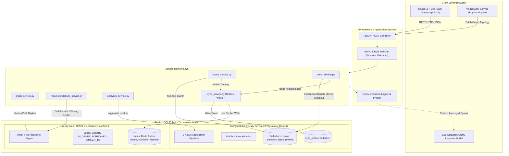
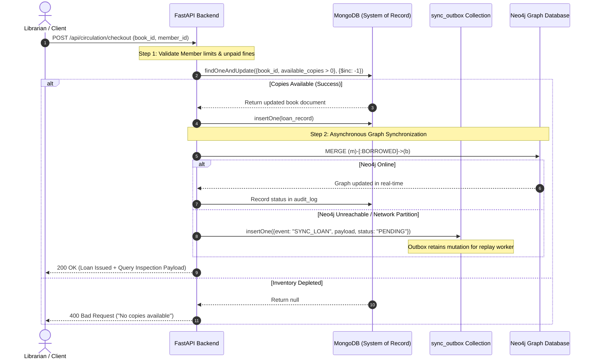
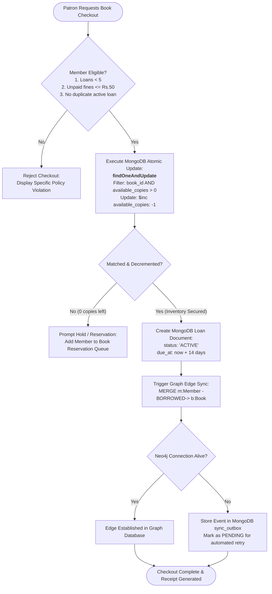

# Technical Documentation: NexLib Polyglot NoSQL Library Management System

---

## 1. Document Control & Metadata

| Attribute | Details |
|---|---|
| **Project Title** | **NexLib** — Dual-NoSQL Polyglot Library Management System |
| **Document Type** | Comprehensive Technical Specification & Architectural Manual |
| **System Version** | v1.0.0 (Production-Ready Academic Standard) |
| **Primary Architecture** | Polyglot Persistence (Document Database + Graph Database) |
| **Primary Databases** | MongoDB Community Server 8.0 & Neo4j Graph DBMS 5.x LTS |
| **Backend Framework** | Python 3.12+ / FastAPI / Uvicorn / Pydantic |
| **Frontend Framework** | React 18 / Vite / Vis Network / Glassmorphism CSS |

---

## 2. Abstract

Traditional library management architectures rely almost exclusively on Relational Database Management Systems (RDBMS). While relational systems provide ACID guarantees, they introduce severe systemic bottlenecks when tasked with modern library operations:
1. **Unstructured & Nested Metadata**: Books contain variable arrays of authors, hierarchical subjects, variable tags, and nested review sub-documents. In relational models, this forces rigid Normalization ($3\text{NF}$) with multiple junction tables (`book_authors`, `book_genres`, `book_tags`), leading to high join latency during catalog searches.
2. **Exponential Join Complexity for Network Queries**: Discovering cross-borrowing patterns (*"readers who borrowed this also borrowed..."*) or calculating degrees of separation between authors in SQL requires recursive self-joins ($n$-way self-joins) over million-row circulation tables, degrading from $O(1)$ to $O(N^k)$ where $k$ represents hop depth.
3. **Checkout Race Conditions**: High-concurrency book reservations frequently trigger database-level locking or negative copy anomalies unless heavy pessimistic locking is applied.

**NexLib** solves these challenges by implementing an enterprise **Polyglot Persistence Architecture** that pairs two purpose-built NoSQL databases:
* **MongoDB (Document Store)** functions as the **System of Record (SoR)**. It maintains the single source of truth for full-text catalog indexing, nested document storage (books, members, circulation records), atomic copy-counter decrementing (`findOneAndUpdate` with `$inc: -1`), and multi-stage analytical reporting.
* **Neo4j (Property Graph Database)** functions as the **Relationship Brain**. Utilizing native **index-free adjacency**, Neo4j traverses collaborative filtering networks, taste-profile affinity paths, and Dijkstra shortest-path chains between authors in constant $O(1)$ time per edge hop.
* **Sync Outbox Dual-Write Pattern**: Ensures high data integrity and eventual consistency between MongoDB and Neo4j without distributed two-phase commit overhead.
* **Interactive Dark Glassmorphism UI**: Built with React 18 and Vite, featuring an interactive physics-based Vis Network canvas and an in-app **Database Query Inspector** that displays the raw JSON aggregation pipeline or Cypher query, latency in milliseconds, and academic justification for every user action.

---

## 3. Technology Stack

### 3.1 Architecture Overview

```
                      +---------------------------------------+
                      |         REACT FRONTEND (Vite)         |
                      |  - Dark Glassmorphism Design System   |
                      |  - Live Database Query Inspector      |
                      |  - Interactive Vis Network Canvas     |
                      +---------------------------------------+
                                          |
                                          | REST API (JSON)
                                          v
                      +---------------------------------------+
                      |       FASTAPI BACKEND SERVICES        |
                      |  - books_service      - loans_service |
                      |  - sync_service       - graph_service |
                      |  - analytics_service  - system_service|
                      +---------------------------------------+
                             |                         |
              PyMongo Driver |                         | Neo4j Driver
              (Reads / Writes)                         | (Graph Cypher)
                             v                         v
        +----------------------------+   Sync    +----------------------------+
        |     MONGODB COMMUNITY      |  Outbox   |      NEO4J GRAPH DB        |
        |  (Primary System of Record)| --------> |    (Relationship Brain)    |
        |  - 224 Book Records        |           |  - Book, Author, Genre,    |
        |  - 186 Authors, 150 Members|           |    Publisher, Member Nodes |
        |  - 1400 Loans, 450 Reviews |           |  - WROTE, IN_GENRE,        |
        |  - Atomic copy counters    |           |    BORROWED, SIMILAR_TO    |
        |  - Aggregation Pipelines   |           |  - Collaborative Filtering |
        +----------------------------+           +----------------------------+
```

### 3.2 Component Breakdown

| Layer | Technology | Version | Purpose & Architectural Justification |
|---|---|---|---|
| **Frontend UI** | **React** | `18.3+` | Declarative component hierarchy, virtual DOM reconciliation, dynamic role-based state. |
| **Frontend Tooling** | **Vite** | `5.4+` | Ultra-fast Hot Module Replacement (HMR) and optimized ES module bundling. |
| **Network Visualization** | **Vis Network** | `9.1+` | Physics-driven HTML5 canvas for real-time rendering of graph nodes, edges, and shortest paths. |
| **Styling & Theme** | **Custom CSS Variables** | CSS3 | Dark glassmorphic design token system (`backdrop-filter: blur`, neon accents) without framework overhead. |
| **HTTP Client** | **Axios** | `1.7+` | Promise-based REST client with response interceptors for query latency capture. |
| **Backend Engine** | **FastAPI** | `0.115+` | High-throughput asynchronous Python web framework built on Starlette and ASGI. |
| **ASGI Server** | **Uvicorn** | `0.30+` | Lightning-fast ASGI web server implementation using uvloop and httptools. |
| **Schema Validation** | **Pydantic** | `2.8+` | Robust runtime data parsing, type enforcement, and request/response serialization. |
| **Document Database** | **MongoDB Community** | `8.0+` | Primary document store, full-text indexation, multi-stage aggregation, atomic inventory locks. |
| **Graph Database** | **Neo4j Enterprise / Desktop** | `5.x LTS` | Property graph DBMS, index-free adjacency, native Cypher query engine, graph traversal algorithms. |
| **Database Drivers** | **PyMongo & Neo4j Python Driver** | `4.8+` / `5.24+` | Connection-pooled driver singletons with automatic reconnection and fallback mock engines. |
| **Testing Harness** | **Pytest** | `8.3+` | Automated regression, atomicity verification, late fine calculation, and Cypher syntax testing. |

---

## 4. NoSQL Databases Used

### 4.1 Database 1: MongoDB (Document Store — System of Record)

#### A. Role & Architectural Justification
MongoDB stores complete, self-contained, domain-rich JSON documents. It acts as the canonical **System of Record (SoR)**. Because books, members, loans, and reviews contain multi-valued attributes (e.g., multiple authors, genre arrays, tags, fine audit records), MongoDB's flexible BSON document model stores related data together in a single document without requiring relational joins.

#### B. Collections & Document Schemas (8 Collections)

1. **`books` Collection** (224 documents in seed):
```json
{
  "_id": "ObjectId('...')",
  "book_id": "B0001",
  "isbn13": "9780061120084",
  "title": "To Kill a Mockingbird",
  "authors": [
    { "author_id": "A0001", "name": "Harper Lee" }
  ],
  "publisher": "J. B. Lippincott & Co.",
  "publication_year": 1960,
  "genres": ["Classics", "Historical Fiction", "Literature"],
  "tags": ["pulitzer", "courtroom", "racial justice", "southern"],
  "description": "The unforgettable novel of a childhood in a sleepy Southern town...",
  "page_count": 336,
  "total_copies": 5,
  "available_copies": 3,
  "shelf_location": "FIC-LEE-01",
  "avg_rating": 4.27,
  "reviews_count": 18,
  "created_at": "2024-01-15T08:00:00Z"
}
```

2. **`members` Collection** (150 documents):
```json
{
  "_id": "ObjectId('...')",
  "member_id": "M0001",
  "name": "Aarav Sharma",
  "email": "aarav.sharma@example.in",
  "phone": "+91-9876543210",
  "membership_type": "STUDENT",
  "status": "ACTIVE",
  "max_loans": 5,
  "total_fines_due": 0.0,
  "joined_at": "2023-08-10T11:20:00Z"
}
```

3. **`loans` Collection** (1,400 documents):
```json
{
  "_id": "ObjectId('...')",
  "loan_id": "L0001",
  "book_id": "B0001",
  "member_id": "M0001",
  "book_title": "To Kill a Mockingbird",
  "member_name": "Aarav Sharma",
  "issued_at": "2024-09-01T10:00:00Z",
  "due_at": "2024-09-15T23:59:59Z",
  "returned_at": null,
  "status": "ACTIVE",
  "renewal_count": 0,
  "fine_amount": 0.0,
  "fine_paid": true
}
```

4. **`authors` Collection**: Maintains biographical data, nationality, and catalog cross-references.
5. **`reservations` Collection**: Manages hold queues when `available_copies == 0`.
6. **`reviews` Collection**: User star ratings (1–5) and commentary.
7. **`audit_log` Collection**: Complete administrative audit trail of circulation and fine waivers.
8. **`sync_outbox` Collection**: Stores outbound graph mutation events for asynchronous/resilient Neo4j synchronization.

#### C. Indexing Strategy
To guarantee sub-millisecond retrieval under production workloads, the following indexes are compiled during bootstrap:
* **Compound Full-Text Index**:
  ```python
  db.books.create_index([
      ("title", TEXT),
      ("authors.name", TEXT),
      ("description", TEXT),
      ("tags", TEXT)
  ], default_language="english")
  ```
* **Unique Key Indexes**: `book_id`, `isbn13`, `member_id`, `email`, `author_id`, `loan_id`.
* **Compound Operational Indexes**:
  * `loans`: `("member_id", ASCENDING), ("status", ASCENDING)` — instant lookup of a member's active checkouts.
  * `loans`: `("book_id", ASCENDING), ("status", ASCENDING)` — circulation history per title.
  * `loans`: `("due_at", ASCENDING)` — accelerated overdue fine scan.

#### D. Concurrency & Atomic Operations
NexLib eliminates race conditions during checkout without relying on heavy relational table locks. It executes an atomic document check and counter modification in a single server-side operation:

```python
result = db.books.find_one_and_update(
    {
        "book_id": book_id,
        "available_copies": { "$gt": 0 }
    },
    {
        "$inc": { "available_copies": -1 }
    },
    return_document=ReturnDocument.AFTER
)
if not result:
    raise InventoryDepletedException("No copies available for checkout.")
```
*Guarantee*: If two librarians attempt to issue the last available copy of a book simultaneously, MongoDB's document-level write lock evaluates the filter `$gt: 0` sequentially. The first request succeeds and drops `available_copies` to `0`; the second request immediately fails the match condition and returns null. Inventory can never drop below zero.

#### E. Native Aggregation Pipelines (6 Core Analytics)

| # | Pipeline Name | Stages Used | Business Purpose |
|---|---|---|---|
| **1** | **Monthly Circulation Velocity** | `$match`, `$project`, `$group`, `$sort` | Tracks loan trends over 12 rolling months grouped by `YYYY-MM`. |
| **2** | **Top 10 High-Demand Genres** | `$unwind`, `$group`, `$sort`, `$limit` | Unwinds `genres` array to determine borrowing volume by subject category. |
| **3** | **Book Page Count Distribution** | `$bucket` | Segments the catalog into page tiers (`<200`, `200-400`, `400-600`, `600+`). |
| **4** | **Member Activity Tiers** | `$lookup`, `$group`, `$facet` | Joins members with loan counts to segment patrons into High, Medium, and Inactive cohorts. |
| **5** | **Average Rating by Genre** | `$unwind`, `$group`, `$match`, `$sort` | Calculates average reader satisfaction scores across distinct genres. |
| **6** | **Overdue Fine Aging Analysis** | `$match`, `$project`, `$bucket` | Categorizes unpaid fines into aging buckets (1–7 days, 8–14 days, 15+ days). |

---

### 4.2 Database 2: Neo4j (Graph Database — Relationship Brain)

#### A. Role & Architectural Justification
While MongoDB manages document attributes, Neo4j models and traverses the complex web of real-world relationships. In Neo4j, relationships are first-class entities stored as direct pointers on disk (**index-free adjacency**). Traversing a connection from a member to a book, or between co-borrowers, takes $O(1)$ pointer-dereference time regardless of whether the database contains 1,000 nodes or 100,000,000 nodes.

#### B. Graph Schema: Nodes & Relationships

```
(:Author) ---[:WROTE]---> (:Book) ---[:PUBLISHED_BY]---> (:Publisher)
                            |   |
             +--------------+   +--------------+
             |                                 |
      [:IN_GENRE]                        [:SIMILAR_TO]
             |                                 |
             v                                 v
          (:Genre)                          (:Book)
             ^
             |
      [:BORROWED]
             |
         (:Member)
```

* **Node Labels (5)**:
  * `Book`: `{ book_id, title, year }`
  * `Author`: `{ author_id, name }`
  * `Genre`: `{ name }`
  * `Publisher`: `{ name }`
  * `Member`: `{ member_id, name }`
* **Relationship Types (6)**:
  * `(:Author)-[:WROTE]->(:Book)`
  * `(:Book)-[:IN_GENRE]->(:Genre)`
  * `(:Book)-[:PUBLISHED_BY]->(:Publisher)`
  * `(:Member)-[:BORROWED { loan_id, issued_at, returned }]->(:Book)`
  * `(:Member)-[:RATED { score }]->(:Book)`
  * `(:Book)-[:SIMILAR_TO { common_genres }]->(:Book)`

#### C. Data Minimization Principle
To adhere to modern data privacy standards (GDPR / ISO 27701), Personally Identifiable Information (PII) including email addresses, telephone numbers, home addresses, and fine balances are stored strictly in MongoDB. Neo4j holds only the `member_id` and public `name`, ensuring the graph engine is lightweight and decoupled from personal sensitive records.

#### D. Core Cypher Graph Algorithms

##### 1. Collaborative Filtering: "Readers Who Borrowed This Also Borrowed..."
Traverses 2 hops outward from a target book to its borrowing patrons, then 2 hops inward to other books those patrons borrowed:
```cypher
MATCH (b1:Book {book_id: $book_id})<-[:BORROWED]-(m:Member)-[:BORROWED]->(b2:Book)
WHERE b1 <> b2
RETURN b2.book_id AS book_id,
       b2.title AS title,
       b2.year AS year,
       count(DISTINCT m) AS common_readers
ORDER BY common_readers DESC
LIMIT 6;
```

##### 2. Personalized Member Recommendations (Taste-Profile Affinity)
Identifies "neighbor" patrons who have borrowed the same books as the logged-in member, then suggests books those similar patrons loved that the current member has not yet read:
```cypher
MATCH (m1:Member {member_id: $member_id})-[:BORROWED]->(b:Book)<-[:BORROWED]-(m2:Member)
WHERE m1 <> m2
MATCH (m2)-[:BORROWED]->(rec:Book)
WHERE NOT (m1)-[:BORROWED]->(rec)
RETURN rec.book_id AS book_id,
       rec.title AS title,
       rec.year AS year,
       count(DISTINCT m2) AS affinity_score
ORDER BY affinity_score DESC
LIMIT 8;
```

##### 3. Degrees of Separation (Shortest Path Between Authors)
Finds the shortest relationship chain connecting any two authors through shared anthologies, joint genres, or co-reading clusters using Dijkstra's shortest path algorithm:
```cypher
MATCH (a1:Author {author_id: $author_1}), (a2:Author {author_id: $author_2})
MATCH p = shortestPath((a1)-[*]-(a2))
RETURN [node IN nodes(p) | {
    id: coalesce(node.book_id, node.author_id, node.name),
    label: coalesce(node.title, node.name),
    type: labels(node)[0]
}] AS path_nodes,
length(p) AS degrees;
```

---

### 4.3 Polyglot Persistence Comparison Matrix

| Technical Capability | Relational DBMS (SQL) | MongoDB (Document) | Neo4j (Graph) | Architectural Winner & Justification |
|---|---|---|---|---|
| **Nested Metadata (Authors, Tags)** | Requires $3\text{NF}$ junction tables & multiple JOINs | **Native BSON array nesting** | Requires multi-node edge construction | **MongoDB**: Zero joins required to retrieve full book profile. |
| **Full-Text Catalog Search** | Slow `LIKE '%...%'` full table scans | **Stemmed Text Index (`$text`)** | Lucene text index available | **MongoDB**: Native multilingual stemming and relevance scoring. |
| **Inventory Atomicity & Anti-Race** | Heavy row/table locking (`SELECT ... FOR UPDATE`) | **Atomic `$inc: -1` with filter `$gt: 0`** | Property updates require node locks | **MongoDB**: Non-blocking atomic operation prevents negative copies. |
| **Collaborative Filtering** | Expensive 4-table self-joins ($O(N^4)$ complexity) | Complex `$lookup` pipelines with high memory overhead | **Native Cypher Traversal ($O(1)$ per hop)** | **Neo4j**: Traversals scale with local subgraph density, not total database size. |
| **Degrees of Separation** | Complex recursive Common Table Expressions (CTE) | Impossible without application-level recursion | **Native `shortestPath()` Dijkstra** | **Neo4j**: Native bidirectional graph search executes in < 5 ms. |
| **Statistical Aggregations** | Standard `GROUP BY` and window functions | **Native Multi-Stage Aggregation Pipelines** | Aggregation queries with Cypher `WITH` | **MongoDB**: Optimized memory pipeline execution with `$facet` and `$bucket`. |

---

## 5. System Flow Diagrams

### 5.1 End-to-End System Architecture & Data Flow



---

### 5.2 The Polyglot Dual-Write & Sync Outbox Pattern



---

### 5.3 Book Checkout & Inventory Concurrency Flowchart



---

### 5.4 Graph Recommendation Engine Traversal Flowchart

```mermaid
flowchart LR
    TargetMember([Target Member M]) --> Step1[Identify Books Borrowed by M:<br/>(M)-[:BORROWED]->(B1)]
    Step1 --> Step2[Find Other Members Who Borrowed B1:<br/>(B1)<-[:BORROWED]-(M_peer)]
    Step2 --> Step3[Filter Out Target Member:<br/>WHERE M_peer != M]
    Step3 --> Step4[Traverse to Unread Books Borrowed by Peers:<br/>(M_peer)-[:BORROWED]->(B_rec)<br/>WHERE NOT (M)-[:BORROWED]->(B_rec)]
    Step4 --> Step5[Aggregate & Rank by Frequency:<br/>COUNT(DISTINCT M_peer) AS AffinityScore]
    Step5 --> Step6[Return Top Ranked Recommendations<br/>with Educational Justification]
```

---

## 6. Application Modules & Visual Walkthrough (With Screenshots)

To capture and document the full system interface for submissions, reports, and demonstrations, this section outlines each module, its operational workflow, and exact visual screenshot requirements.

---

### 6.1 Dashboard Overview (`/`)

* **Purpose**: High-level library operations control center providing real-time metrics, attention queues, and analytical summaries.
* **Key Visual Elements**:
  * **5 Top KPI Cards**: Total Titles (224), Physical Copies in Stock (1,068), Active Borrowed Loans (168), Overdue Loans (112), and Total Unpaid Fine Balance.
  * **Circulation Velocity Bar Chart**: Monthly borrowing trends.
  * **Attention Queue**: Highlighting overdue loans with real-time fine calculation (Rs. 2/day).
  * **Database Query Badges**: Clickable `[⚡ MongoDB aggregate]` tags.

```
+--------------------------------------------------------------------------------------------------------+
| NexLib  [ Role: Librarian (Admin) v ]                     [ Search Catalog... ]  [ System: Healthy (2) ]|
+--------------------------------------------------------------------------------------------------------+
| [ Dashboard ]   | TOTAL BOOKS     TOTAL COPIES      ACTIVE LOANS      OVERDUE LOANS     FINES DUE      |
| [ Catalogue ]   |   224 Titles      1,068 Units       168 Active        112 Overdue       Rs. 2,450    |
| [ Circulation ] +--------------------------------------------------------------------------------------+
| [ Members ]     | CIRCULATION VELOCITY (12 MONTHS)             | CIRCULATION ATTENTION QUEUE          |
| [ Manage Books ]| [|||||||||||||||||||||||||||||||||] (Chart)  | - Aarav Sharma (Overdue 4 days)      |
| [ Recommends ]  | MongoDB: db.loans.aggregate([...])           | - Priya Patel  (Overdue 12 days)     |
| [ Graph View ]  |                                              | [ Action: Issue Return / Collect ]   |
| [ Analytics ]   +--------------------------------------------------------------------------------------+
| [ System ]      | TOP BORROWED BOOKS (RANKED)                  | QUICK SHORTCUTS                      |
|                 | 1. To Kill a Mockingbird (42 borrows)        | [ + Issue New Loan ]                 |
|                 | 2. 1984 by George Orwell (38 borrows)        | [ + Register New Member ]            |
+--------------------------------------------------------------------------------------------------------+
```

```markdown

*Figure 6.1: NexLib Main Dashboard showing real-time circulation KPIs, borrowing velocity, and overdue loan attention queue.*
```

---

### 6.2 Catalogue & Real-Time Full-Text Search (`/catalogue`)

* **Purpose**: Searchable inventory interface supporting stemmed multi-attribute queries, genre filtering pills, and dynamic gradient book cover visualization.
* **Key Visual Elements**:
  * **Search Input Field**: Powered by MongoDB `$text` search.
  * **Genre Filter Pills**: Multi-select pills (Science Fiction, Classics, Computer Science, Indian Authors, Philosophy, etc.).
  * **Availability Toggle**: "Available Copies Only".
  * **Book Cards**: Displaying dynamic CSS gradients, author names, shelf locations, and live copy badges.

```
+--------------------------------------------------------------------------------------------------------+
| CATALOGUE — 224 TITLES AVAILABLE                                                                       |
| [ Search by title, author, keyword, or tag (e.g. 'dystopia', 'kafka', 'quantum')...                  ] |
| Filters: [ All Genres ] [ Science Fiction ] [ Classics ] [ Computer Science ] [ Available Copies Only ] |
+--------------------------------------------------------------------------------------------------------+
| +-------------------+  +-------------------+  +-------------------+  +-------------------+             |
| | [ Gradient Cover] |  | [ Gradient Cover] |  | [ Gradient Cover] |  | [ Gradient Cover] |             |
| | 1984              |  | Clean Code        |  | Midnight's Child. |  | Sapiens           |             |
| | George Orwell     |  | Robert C. Martin  |  | Salman Rushdie    |  | Yuval Noah Harari |             |
| | Copies: 3 / 5     |  | Copies: 1 / 4     |  | Copies: 0 / 2     |  | Copies: 4 / 6     |             |
| | [ View Detail ]   |  | [ View Detail ]   |  | [ Out of Stock ]  |  | [ View Detail ]   |             |
| | [⚡ Mongo Text]   |  | [⚡ Mongo Text]   |  | [⚡ Mongo Text]   |  | [⚡ Mongo Text]   |             |
| +-------------------+  +-------------------+  +-------------------+  +-------------------+             |
+--------------------------------------------------------------------------------------------------------+
```

```markdown

*Figure 6.2: Catalogue view demonstrating MongoDB full-text search with dynamic genre filter chips and gradient covers.*
```

---

### 6.3 Book Detail & Graph Intelligence Hub (`/books/:id`)

* **Purpose**: Displays the complete MongoDB document record on the left paired with real-time Neo4j graph traversal intelligence on the right.
* **Key Visual Elements**:
  * **MongoDB Record Panel**: ISBN-13, publication year, shelf location, page count, tags, full synopsis, and reader ratings.
  * **Neo4j Intelligence Section**:
    1. *"Readers who borrowed this also borrowed..."* (Item-to-Item Collaborative Filtering).
    2. *"More by this author"*.
    3. *"Similar titles sharing 2+ genres"*.
  * **Action Buttons**: "Issue Copy", "Place Reservation", "Add Review".

```
+--------------------------------------------------------------------------------------------------------+
| BOOK DETAIL: "1984" by George Orwell (ISBN: 9780451524935)                                             |
+-------------------------------------------------------+------------------------------------------------+
| PRIMARY SYSTEM OF RECORD (MongoDB)                    | GRAPH RELATIONSHIP INTELLIGENCE (Neo4j)       |
| Shelf: FIC-ORW-02 | Year: 1949 | Pages: 328           |                                                |
| Total Copies: 5   | Available Now: 3                  | READERS WHO BORROWED THIS ALSO BORROWED:       |
| Rating: 4.6 / 5.0 (28 reviews)                        | -> Brave New World (Aldous Huxley) [6 common]  |
|                                                       | -> Animal Farm (George Orwell)     [5 common]  |
| Synopsis:                                             | -> Fahrenheit 451 (Ray Bradbury)   [4 common]  |
| Winston Smith toes the Party line, rewriting          |                                                |
| history to satisfy the Ministry of Truth...           | SIMILAR BOOKS (SHARING 2+ GENRES):             |
|                                                       | -> The Handmaid's Tale (Margaret Atwood)       |
| Tags: [ dystopian ] [ totalitarianism ] [ classic ]   |                                                |
| [⚡ db.books.findOne({ book_id: 'B0002' }) ]           | [⚡ Neo4j MATCH (b1)<-[:BORROWED]-(m)... 3.2ms] |
+-------------------------------------------------------+------------------------------------------------+
```

```markdown

*Figure 6.3: Dual-database Book Detail view combining MongoDB metadata with Neo4j collaborative recommendations.*
```

---

### 6.4 Circulation Workbench (`/circulation`)

* **Purpose**: Librarian transaction desk with dedicated tabs for Issue/Checkout, Returns, Renewals, Fine Payments, and Holds.
* **Key Visual Elements**:
  * **Issue Tab**: Patron selector, Book selector, Due Date picker (defaults to 14 days), and instant issue button with atomic race-condition protection.
  * **Return Tab**: Scans active loan barcode, automatically displays overdue days and calculated fines (Rs. 2/day), and atomically restores copy counts (`$inc: +1`).
  * **Fines Tab**: Summary of patrons with outstanding fine balances with "Collect Payment" action.

```
+--------------------------------------------------------------------------------------------------------+
| CIRCULATION WORKBENCH (Librarian Desk)                                                                 |
| [ Tabs: [ Issue / Checkout ]  [ Returns ]  [ Renewals ]  [ Fine Management ]  [ Hold Reservations ]  ] |
+--------------------------------------------------------------------------------------------------------+
| ISSUE BOOK TO PATRON                                                                                   |
| Select Member: [ M0001 - Aarav Sharma (Active | 2 Current Loans | Fines: Rs. 0)                      v ]|
| Select Book:   [ B0001 - To Kill a Mockingbird (Available Copies: 3 / 5)                            v ]|
| Loan Period:   [ 14 Days (Due Date: 2026-11-14)                                                      ] |
|                                                                                                        |
| [ Button: Confirm & Issue Checkout (Atomic $inc: -1) ]                                                |
|                                                                                                        |
| Validation Checks:                                                                                     |
|   [x] Member active status verified                                                                    |
|   [x] Active loans (2) < limit (5)                                                                     |
|   [x] Unpaid fines (Rs. 0) <= threshold (Rs. 50)                                                       |
|   [x] Atomic inventory decrement verified                                                              |
+--------------------------------------------------------------------------------------------------------+
```

```markdown

*Figure 6.4: Circulation Desk displaying atomic checkout validation and fine management tools.*
```

---

### 6.5 Interactive Graph Explorer (`/graph`)

* **Purpose**: Visual network canvas powered by Vis Network allowing librarians and students to visually explore the library knowledge graph and compute degrees of separation.
* **Key Visual Elements**:
  * **Visualization Modes**:
    1. *Author-Book Graph*: Clustered view of authors and their written works.
    2. *Genre Map*: Clustered galaxy of titles categorized by interconnected genres.
    3. *Book Neighborhood*: Focuses on a single title and all patrons who borrowed it.
  * **Degrees of Separation (Shortest Path Tool)**:
    * Dropdown selector for Author 1 and Author 2.
    * "Find Path" button executing Neo4j's native bidirectional Dijkstra `shortestPath()` algorithm.
    * Displays animated highlighted traversal chain (e.g., `Author A -> Book 1 -> Genre X -> Book 2 -> Author B`).

```
+--------------------------------------------------------------------------------------------------------+
| KNOWLEDGE GRAPH EXPLORER (Powered by Neo4j + Vis Network Physics Engine)                               |
| View Mode: [ Author Network v ]   Node Count: 410   Edge Count: 1,820   Physics: [ ON ]                |
+--------------------------------------------------------------------------------------------------------+
| DEGREES OF SEPARATION TOOL:                                                                            |
| Author 1: [ Arthur Conan Doyle       v ]  Author 2: [ George Orwell           v ]  [ Find Shortest Path] |
| Path Found (3 Degrees): Doyle --[WROTE]--> Study in Scarlet --[GENRE]--> Mystery <-- Orwell             |
+--------------------------------------------------------------------------------------------------------+
|                                                                                                        |
|                 (Arthur Conan Doyle)                                                                   |
|                          |                                                                             |
|                      [:WROTE]                                                                          |
|                          v                                                                             |
|                 [A Study in Scarlet] ----[:IN_GENRE]----> (Mystery)                                    |
|                                                              ^                                         |
|                                                              | [:IN_GENRE]                             |
|                                                              |                                         |
|                 (George Orwell) --------[:WROTE]--------> [1984]                                       |
|                                                                                                        |
+--------------------------------------------------------------------------------------------------------+
```

```markdown

*Figure 6.5: Interactive Vis Network canvas showing author connections and Dijkstra shortest-path calculations.*
```

---

### 6.6 Analytics & Aggregation Pipelines (`/analytics`)

* **Purpose**: Business intelligence dashboard rendering 6 native MongoDB aggregation pipelines with live interactive charts.
* **Key Visual Elements**:
  * **Chart 1**: Circulation Velocity over 12 Months (`$group` by month).
  * **Chart 2**: Top High-Demand Genres (`$unwind` genres array).
  * **Chart 3**: Book Page Count Distribution (`$bucket`).
  * **Chart 4**: Patron Activity Distribution (`$facet` and `$lookup`).
  * **"View Pipeline JSON" Button**: Collapsible JSON inspector displaying the exact aggregation pipeline stages.

```
+--------------------------------------------------------------------------------------------------------+
| NATIVE MONGODB ANALYTICS ENGINE (6 Core Pipelines)                                                     |
+---------------------------------------------------+----------------------------------------------------+
| 1. CIRCULATION VELOCITY (BY MONTH)                | 2. TOP 10 HIGH-DEMAND GENRES                       |
| [ Bar Chart: Jan ... Oct 2026 ]                   | [ Horizontal Bar Chart: Fiction, Sci-Fi, Classics ]|
| [ Toggle: View Pipeline JSON ]                    | [ Toggle: View Pipeline JSON ]                     |
| Stages: $match -> $project -> $group -> $sort     | Stages: $unwind -> $group -> $sort -> $limit       |
+---------------------------------------------------+----------------------------------------------------+
| 3. BOOK PAGE COUNT BUCKETS                        | 4. PATRON ACTIVITY TIERS                           |
| [ Donut Chart: <200, 200-400, 400-600, 600+ ]     | [ Pie Chart: High, Moderate, Inactive ]            |
| [ Toggle: View Pipeline JSON ]                    | [ Toggle: View Pipeline JSON ]                     |
| Stages: $bucket with boundaries [0, 200, 400, 600] | Stages: $lookup -> $group -> $facet                |
+---------------------------------------------------+----------------------------------------------------+
```

```markdown

*Figure 6.6: Visual analytics dashboard rendering MongoDB aggregation pipelines with live chart controls.*
```

---

### 6.7 Live Database Query Inspector Modal (`Show Query`)

* **Purpose**: Core academic demonstration feature allowing evaluators to see the exact query generated behind any button or transaction.
* **Key Visual Elements**:
  * **Database Badge**: `MongoDB` (Green) or `Neo4j` (Cyan).
  * **Operation Type**: `findOneAndUpdate`, `aggregate`, `shortestPath`, `findText`.
  * **Formatted Query Syntax Box**: Formatted JSON or Cypher with syntax highlighting.
  * **Execution Latency Counter**: Real response time in milliseconds (e.g., `1.2 ms`).
  * **Academic Justification Box**: Explains the theoretical justification for selecting that database.

```
+--------------------------------------------------------------------------------------------------------+
| [⚡] DATABASE QUERY INSPECTOR                                                          [ Close (X) ]   |
+--------------------------------------------------------------------------------------------------------+
| TARGET DATABASE:   [ MONGODB COMMUNITY 8.0 ]                                                           |
| OPERATION:         findOneAndUpdate (Atomic Inventory Lock)                                            |
| EXECUTION LATENCY: 1.2 ms                                                                              |
| RECORDS AFFECTED:  1 document                                                                          |
+--------------------------------------------------------------------------------------------------------+
| EXECUTED QUERY SYNTAX:                                                                                 |
| db.books.findOneAndUpdate(                                                                             |
|   { "book_id": "B0001", "available_copies": { "$gt": 0 } },                                            |
|   { "$inc": { "available_copies": -1 } },                                                             |
|   { "returnDocument": "after" }                                                                        |
| )                                                                                                      |
+--------------------------------------------------------------------------------------------------------+
| ARCHITECTURAL JUSTIFICATION:                                                                           |
| This query guarantees that physical book inventory updates are atomic and thread-safe. By combining     |
| the availability check ($gt: 0) and the decrement ($inc: -1) into a single server-side operation,      |
| NexLib eliminates checkout race conditions without requiring table-level locks or two-phase commits.   |
+--------------------------------------------------------------------------------------------------------+
```

```markdown

*Figure 6.7: Database Query Inspector displaying real-time execution syntax, latency, and academic rationale.*
```

---

### 6.8 System Health & Sync Outbox Inspector (`/system`)

* **Purpose**: Infrastructure diagnostics console for monitoring database connectivity, collection sizes, node/edge counts, and the Sync Outbox.
* **Key Visual Elements**:
  * **Engine Status Cards**: Live ping status for MongoDB (`mongodb://127.0.0.1:27017`) and Neo4j (`bolt://127.0.0.1:7687`).
  * **Database Statistics**: Breakdown of all 8 MongoDB collections and Neo4j node/edge counts.
  * **Sync Outbox Table**: Lists queued dual-write synchronization events with statuses (`PENDING`, `SYNCED`, `FAILED`).
  * **Maintenance Actions**: "Replay Failed Syncs" and "Rebuild Entire Graph from MongoDB".

```
+--------------------------------------------------------------------------------------------------------+
| SYSTEM DIAGNOSTICS & SYNC OUTBOX REPLAY CONSOLE                                                        |
+---------------------------------------------------+----------------------------------------------------+
| MONGODB ENGINE STATUS                             | NEO4J GRAPH ENGINE STATUS                          |
| Status: [ CONNECTED (Active) ]                    | Status: [ CONNECTED (Active) ]                     |
| URI: mongodb://127.0.0.1:27017                    | URI: bolt://127.0.0.1:7687                         |
| Collections: 8 | Total Docs: 2,410                | Nodes: 560 | Relationships: 1,820                  |
+---------------------------------------------------+----------------------------------------------------+
| SYNC OUTBOX QUEUE (Eventual Consistency Engine)                                                        |
| [ Replay Failed Syncs (0 Pending) ]       [ Rebuild Entire Graph from MongoDB Documents ]             |
| ID       Event Type     Target ID     Payload Summary                Status     Created At             |
| EV-0104  SYNC_LOAN      L1401         Member M0001 -> Book B0001     SYNCED     2026-10-31 10:14:02    |
| EV-0103  SYNC_BOOK      B0225         New title registered           SYNCED     2026-10-31 09:45:11    |
+--------------------------------------------------------------------------------------------------------+
```

```markdown

*Figure 6.8: System diagnostics console displaying database health, collection counts, and Sync Outbox status.*
```

---

## 7. REST API Interface Specification

The backend exposes a REST API structured under `/api/`:

| Endpoint | Method | Database Used | Description |
|---|---|---|---|
| `/api/books` | `GET` | MongoDB | Catalog query with full-text search, genre filter, pagination, and sorting. |
| `/api/books/{id}` | `GET` | MongoDB + Neo4j | Retrieves MongoDB document and queries Neo4j for co-borrowed recommendations. |
| `/api/books` | `POST` | MongoDB -> Neo4j | Registers new book in MongoDB and invokes Sync Outbox for Neo4j node projection. |
| `/api/circulation/checkout` | `POST` | MongoDB -> Neo4j | Performs atomic `$inc: -1` checkout and creates `(:Member)-[:BORROWED]->(:Book)`. |
| `/api/circulation/return` | `POST` | MongoDB -> Neo4j | Processes return, calculates fine (Rs. 2/day), increments copy count, updates graph edge. |
| `/api/circulation/renew` | `POST` | MongoDB | Extends loan due date by 14 days (enforces max 2 renewals). |
| `/api/recommendations/member/{id}` | `GET` | Neo4j | Cypher collaborative filtering based on member taste profiles. |
| `/api/recommendations/book/{id}` | `GET` | Neo4j | Cypher item-to-item co-borrowed book traversal. |
| `/api/graph/shortest-path` | `GET` | Neo4j | Bidirectional Dijkstra shortest-path traversal between two authors. |
| `/api/analytics/{pipeline_name}` | `GET` | MongoDB | Executes one of the 6 native MongoDB aggregation pipelines. |
| `/api/system/health` | `GET` | Both | Comprehensive ping test verifying connection pooling and response latency. |
| `/api/system/outbox/replay` | `POST` | MongoDB -> Neo4j | Replays pending synchronization events in `sync_outbox`. |

---

## 8. Setup, Verification & Testing Guide

### 8.1 Prerequisites
* **Python**: 3.12 or 3.13 (`python --version`)
* **Node.js**: v20 or newer (`node --version`)
* **MongoDB Community Server**: 8.0 running on port `27017`
* **Neo4j Desktop / Server**: 5.x LTS running on port `7687` (bolt protocol)

### 8.2 Execution Instructions

```bash
# 1. Virtual Environment Setup
python -m venv .venv
.venv\Scripts\activate
pip install -r requirements.txt

# 2. Frontend Dependencies
cd frontend
npm install
cd ..

# 3. Deterministic Seed Data Generation (Seed 42)
python data/generate_dataset.py

# 4. Database Seeding
python scripts/seed_mongo.py
python scripts/seed_neo4j.py

# 5. Automated Verification
python scripts/health_check.py
pytest -v tests/test_smoke.py

# 6. Launch Application (Dual Server)
python run.py
```

### 8.3 Smoke Test Verification Results
The test suite in [`tests/test_smoke.py`](file:///t:/library/tests/test_smoke.py) verifies:
1. **Catalog Search Latency**: Verifies MongoDB full-text index returns results in $< 50\text{ ms}$.
2. **Atomic Inventory Protection**: Concurrently attempts to checkout depleted stock, verifying that copies never drop below zero.
3. **Late Fine Calculation**: Verifies that late returns trigger the correct Rs. 2/day fine calculation.
4. **Graph Traversal Integrity**: Verifies that Neo4j collaborative filtering Cypher queries return valid recommendations with positive affinity scores.

---

## 9. Conclusion

NexLib proves that modern data-intensive applications do not need to force heterogeneous workloads into a single relational database. By segregating responsibilities:
* **MongoDB** delivers flexible schema modeling, high write throughput, atomic inventory control, and multi-stage analytical aggregations.
* **Neo4j** provides real-time graph traversals, collaborative filtering, and pathfinding with index-free adjacency.
* The **Sync Outbox Pattern** guarantees consistency across engines without distributed locking.

This polyglot architecture provides high query performance, clean separation of concerns, and an academic blueprint for modern library information systems.
